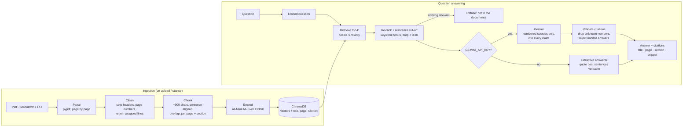

# Academic Resource RAG Search Engine

Ask questions about policy handbooks and academic documents, and get answers built **only** from those documents. Every claim carries a citation to the exact document, page and section. If the documents don't cover a question, the app says so instead of guessing.

**Live demo:** deploying to Hugging Face Spaces (link coming soon)

   

## Features

- **Ingestion pipeline** for PDF, Markdown and text. It strips running headers and page numbers, tracks section headings, and splits text into sentence-aligned chunks that never cross a page or section.
- **Local vector search.** Embeddings come from all-MiniLM-L6-v2 running locally on ONNX Runtime and are stored in ChromaDB (cosine similarity), so indexing and search need no API key and cost nothing.
- **Grounded answers.**
  - With a Gemini API key, the model sees only the numbered retrieved chunks and must cite one for every claim. Answers with no valid citation are rejected.
  - Without a key, an extractive answerer quotes the most relevant sentences verbatim. It can't hallucinate, because every word comes from a source.
- **Precise citations.** Citation chips link each claim to its source passage, with the document title, page and section. The original PDF opens at that page.
- **Refuses off-topic questions.** Chunks below a relevance cut-off are thrown away, and if nothing is left, the app declines to answer.
- **Side-by-side UI.** The chat sits on the left and the source passages on the right, with the quoted sentences highlighted. There's also an **Ask** / **Search** toggle and a filter to scope questions to one document.
- **Upload.** Drag in a PDF and it's chunked, embedded and searchable within seconds.

## RAG pipeline architecture



| Stage | Where | What it does |
| --- | --- | --- |
| Parse and clean | [`app/ingest.py`](app/ingest.py) | Reads PDFs page by page. Drops lines repeated on every page (running headers) and page-number footers, re-joins hyphenated words, and keeps bullet items whole. |
| Chunk | [`app/ingest.py`](app/ingest.py) | Detects headings (`3.1 Late Submission`, `EXAM RULES`, Markdown `#`) and packs sentences into chunks of about 900 characters with about 160 characters of overlap. A chunk never spans two pages or sections, so its citation is exact. |
| Embed and store | [`app/store.py`](app/store.py) | Embeds `title. section. text` for each chunk, so short chunks still match questions phrased around their heading. Stores the vector with `doc_id`, `title`, `page`, `section` in a persistent ChromaDB collection (cosine space). |
| Retrieve | [`app/rag.py`](app/rag.py) | Takes the top 15 candidates by cosine similarity, drops those below 0.30, and re-ranks the rest with a keyword-overlap bonus. Keeps the top 5. |
| Generate | [`app/rag.py`](app/rag.py) | **Gemini mode:** a strict system prompt with numbered sources and temperature 0.1. The answer must cite `[n]` or reply `NOT_FOUND`. Citations are checked against the source list, and answers with none are replaced by the extractive answer. **Extractive mode:** scores every sentence by similarity to the question, the relevance of its chunk and keyword overlap, then quotes the best ones with their citation. |
| Serve | [`app/main.py`](app/main.py) | A FastAPI JSON API plus a static single-page UI ([`app/static`](app/static)). |

### Why chunks never cross a page

A chunk that starts on page 2 and ends on page 3 can only be cited as "pages 2–3", and the quoted sentence may not be on the page the user opens. Splitting at page and section boundaries costs a few slightly shorter chunks but makes every citation point at the exact page and heading.

## Sample documents

[`data/samples`](data/samples) holds five documents for **Northbridge Polytechnic**, a fictional school, written for this project:

- Academic Policy Handbook (attendance, grading, late submission, academic integrity, appeals)
- Examination Regulations (admission, permitted items, medical absence, supplementary exams)
- Student Code of Conduct
- IT and Library Services Guide
- Internship Programme FAQ (Markdown, so citations use sections instead of pages)

The PDFs are generated by [`scripts/make_samples.py`](scripts/make_samples.py). They're indexed automatically on startup and can't be deleted from the UI.

## Run it locally

Requires Python 3.12. ChromaDB and ONNX Runtime don't have wheels for newer Pythons yet.

```bash
python -m venv .venv
.venv\Scripts\activate          # macOS/Linux: source .venv/bin/activate
pip install -r requirements-dev.txt
uvicorn app.main:app --port 8000
```

Open http://localhost:8000. The first start downloads the 80 MB embedding model once.

To use Gemini for answers, set a key from [Google AI Studio](https://aistudio.google.com/apikey) before starting:

```bash
set GEMINI_API_KEY=your-key       # macOS/Linux: export GEMINI_API_KEY=your-key
```

### Configuration

| Variable | Default | Purpose |
| --- | --- | --- |
| `GEMINI_API_KEY` | (unset) | Enables LLM answers. Without it, extractive mode is used. |
| `GEMINI_MODEL` | `gemini-3.6-flash` | Model used for generation |
| `TOP_K` | `5` | Chunks passed to the answerer |
| `MIN_SIMILARITY` | `0.30` | Relevance cut-off (cosine similarity) |
| `CHUNK_CHARS` / `CHUNK_OVERLAP` | `900` / `160` | Chunk size and overlap |
| `DATA_DIR` | `./data` | Where ChromaDB, uploads and the document registry live |
| `MAX_UPLOAD_MB` / `MAX_UPLOADED_DOCS` | `10` / `25` | Upload limits (oldest uploads are removed past the cap) |

## API

| Method | Path | Body | Returns |
| --- | --- | --- | --- |
| `POST` | `/api/ask` | `{ "question": "...", "top_k": 5, "doc_ids": ["..."] }` | `answer`, `found`, `mode`, `sources[]` (`n`, `title`, `page`, `section`, `text`, `similarity`, `cited`) |
| `POST` | `/api/search` | `{ "query": "...", "top_k": 8 }` | Ranked passages, no generation |
| `GET` | `/api/documents` | | Indexed documents |
| `POST` | `/api/documents` | multipart `file` | Ingests a PDF / MD / TXT |
| `DELETE` | `/api/documents/{id}` | | Removes an uploaded document |
| `GET` | `/api/documents/{id}/file` | | The original file (append `#page=N` for PDFs) |
| `GET` | `/api/health` | | Answer mode, model, counts |

Interactive docs are at `/docs`.

## Tests

```bash
pytest -q
```

The 25 tests cover:

- Parsing: titles, pages, sections, header stripping, bullets, overlap.
- Retrieval and citations: the right page and section are cited, and extractive answers are verbatim quotes.
- Refusing off-topic questions.
- The Gemini path, with the network call mocked: valid citations, uncited answers rejected, `NOT_FOUND`, and API failure falling back.
- The full API: upload, ask, open and delete; rejected uploads; protected samples.

## Deployment

The app runs as a Docker Space on Hugging Face ([`Dockerfile`](Dockerfile)). The embedding model is baked into the image, so a cold start needs no downloads.

- The CI workflow runs the tests on every push. When the repo has an `HF_TOKEN` secret, it then publishes the app to the Space with [`scripts/deploy_space.py`](scripts/deploy_space.py).
- An optional `GEMINI_API_KEY` repo secret is copied to the Space as a secret.
- Uploaded documents on the Space are kept until the Space restarts. The sample documents are always re-indexed.

## Limitations

- The small embedding model works on meaning, but it doesn't know every synonym. A question about "ChatGPT" doesn't match a section about "generative AI tools", so the app refuses rather than guessing. Rephrasing fixes it, and a larger embedding model would too.
- Scanned PDFs have no text layer and need OCR before upload.
- Extractive mode quotes sentences rather than writing a summary. It's accurate, but less fluent than LLM mode.
